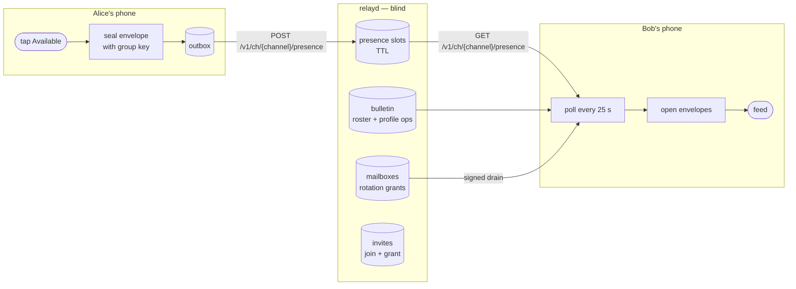

# Architecture Overview

> The mental model of Porch as the code stands, with pointers to where each part lives.
> For *why* each decision was made, see [`docs/adr/`](../adr/) (the capability-channel
> relay is [ADR-0006](../adr/0006-capability-channels-no-session-plane.md)); the frozen
> design is [build-spec](../explanation/build-spec.md); what is real is
> [HONEST-STATUS](../../HONEST-STATUS.md). Everything here is built and host-tested;
> none of it has run on a phone, and no relay is deployed.

## In one paragraph

Porch is a **presence signal** with two parts: a **Flutter app** and a **blind Go relay**
(`relayd`). The app holds the identity (16 bytes shown as 12 words), the display name, the
contact note and every group key; none of it leaves the device in plaintext. A group is
reached through a **channel**: an address derived from the group's current key, so only
members can find it and the relay cannot link it to anyone. Turning the light *On* seals a
presence envelope with the group key and posts it to the channel with a TTL; friends poll
the channel, decrypt, and see the light. The relay has no accounts and no logs, and it
never parses a blob.

## The system at a glance

## The app (`app/lib/`)

Clean layers, each with host tests under `app/test/<layer>/`:

| Layer | What it holds | Notable files |
|---|---|---|
| `domain/` | pure crypto and rules, no Flutter | `identity.dart` (identity, backup blob and its 6 backup words), `keyring.dart` (channel and slot ids from the group key), `envelope.dart`, `roster.dart` (signed membership ops, deterministic fold, admin succession), `rotation.dart`, `invite.dart` |
| `data/` | relay client, persistence, repositories | `api_client.dart` (HTTP), `outbox.dart`, `sync_service.dart`, `presence_repo.dart`, `group_repo.dart`, `invite_repo.dart`, `state_store*.dart` (encrypted state file), `relay_config.dart` (relay URL, placeholder detection) |
| `presentation/` | Riverpod wiring and screens | `providers.dart` (one `PorchActions` method per user intention), `onboarding/`, `home/`, `groups/`, `join/`, `settings/` |
| `bootstrap.dart` | the one place platform adapters are bound | secure storage, libsodium, documents dir, backup folder, share sheet |

Crypto is libsodium through `sodium` / `sodium_libs`, pinned exact. The layering is
enforced by `test/domain/purity_test.dart` and `test/data/purity_test.dart`.

## The relay (`relay/`)

One stdlib binary, `cmd/relayd`, serving the twelve routes in `internal/api/` over a
`Store` interface with in-memory and Redis implementations (`internal/store/`). Access is
by **knowledge**: knowing a channel, invite or mailbox id is the capability. The one
signed request is the mailbox drain. Details, limits and status codes:
[server-api](../reference/server-api.md). Deployment: [DEPLOY](../../relay/ops/DEPLOY.md).

## The flows

- **Presence.** Tap → `PresenceRepo` seals an envelope per chosen group → the outbox posts
  it to that group's channel with the chosen TTL. The tap is optimistic: the light is on
  locally at once and the outbox retries. With no relay configured, nothing can leave and
  Home says so.
- **Refresh** (`SyncService`, every 25 s while the app is open, and on pull-to-refresh):
  flush the outbox → fold bulletin ops by sequence → drain this device's mailbox → adopt
  rotations → read and decode presence → save snapshots stamped with `fetchedAt`, so an old
  snapshot is shown as old.
- **Invites.** The inviter creates an invite id (72 h), the invitee posts a join intro, the
  inviter's next refresh fetches it and posts a grant, and the invitee takes the grant,
  which the relay deletes on retrieval.
- **Membership change.** Removing a member rotates the group key: a new channel, with the
  new key sealed to each remaining member's mailbox. Leaving is silent.
- **Backup.** A blob (Argon2id + XChaCha20-Poly1305) of the identity and the local
  state, locked by 6 backup words Porch derives from the identity, written to a folder no
  automatic backup takes and offered to the share sheet; restore is on the first screen.
  The relay never sees it.

## Where the trust lives

- **The device** is trusted with everything. Endpoint compromise is out of scope.
- **The relay** is trusted only to store and return bytes and to expire them. At full
  compromise it holds ciphertext and unlinkable addresses. It sees a device's public key
  during a mailbox drain but does not store it, and it sees whatever it could observe of IPs and timing (not logged, but
  observable; see [limitations](../limitations.md)).
- **Friends** see what a group member sees: your name, contact note and light, only in the
  groups you share.
